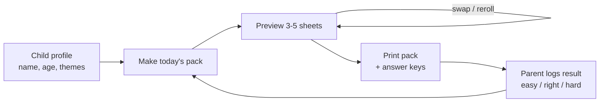
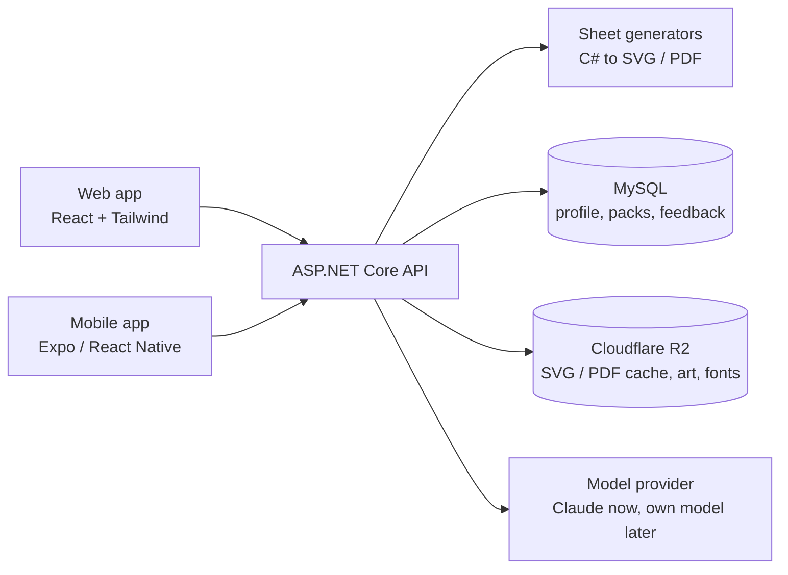

# Focus Fun: ADHD-Friendly Printable Activity App — Build Spec

Sep 24, 2026

## Overview and goals

Focus Fun is a free, personal web app that generates printable activity sheets for a 6–8 year old with ADHD, tuned to what keeps that one child engaged.

It is built around what he loves: **vehicles** as the main theme, **Hindi and Telugu alphabets** alongside English, **paper arts** (cut, fold, build), and **puzzles**.

It replaces paid apps that are generic and not adjustable. A parent picks a theme and difficulty, the app builds a short activity pack, and it prints cleanly on A4 or US Letter.

Success after 4 weeks of use:

- The child completes a 3–5 sheet pack in 15–20 minutes, most days, without a fight.
- Difficulty adjusts so roughly 70–80% of sheets feel achievable.
- A parent can make and print a new pack in under 1 minute.
- No new sheet looks exactly like an old one (generated, not a fixed library).

Out of scope for v1: accounts for multiple families, app-store release, screen-based games the child plays on a device.

## Design principles for ADHD-friendly sheets

Every sheet should be short, clear and quickly winnable; these rules apply to all generators.

- **Short tasks.** Each sheet takes 3–5 minutes. Better many small wins than one long sheet.
- **One instruction, one task per sheet.** Instruction at the top in large text (18pt+), max 1 sentence, with an icon.
- **Low clutter.** White space, thick lines, no busy backgrounds or decorative borders that compete with the task.
- **Interest themes.** Vehicles appear on nearly every sheet (cars, trains, buses, tractors, fire trucks, autorickshaws, planes, rockets) to hook attention.
- **Variety.** A pack rotates activity types; never two of the same type in a row.
- **Visible progress.** Each sheet has a "done" star box to tick, and each pack has a small reward tracker.
- **Adjustable difficulty.** 3 levels per activity (Easy / Medium / Challenge), changed by the parent in one tap.
- **Movement breaks.** Optional "wiggle card" between sheets (e.g. 10 jumping jacks) printed as a half page.

These are practical classroom-style guidelines, not medical treatment; they work best alongside any support your child already has.

## Activity modules

The app ships 5 modules with 17 sheet types, all vehicle-themed by default and generated by code so every sheet is new.

| Module | Sheet type | Skill it trains | Easy | Medium | Challenge |
| --- | --- | --- | --- | --- | --- |
| Puzzles | Road maze ("drive the car to the garage") | Planning, persistence | 6×6 grid, wide roads | 10×10 | 14×14, dead ends, tolls to collect |
| Puzzles | Dot-to-dot vehicle | Sequencing, counting | 1–15 | 1–30 | 1–50, count by 2s |
| Puzzles | Spot the difference (two traffic scenes) | Visual attention | 3 differences | 5 | 8 |
| Puzzles | Word search (vehicle words) | Scanning, focus | 5 words, 8×8, across only | 8 words, 10×10 | 10 words, diagonals |
| Puzzles | Picture sudoku (vehicle icons) | Logic | 4×4 with 2 icons missing per row | 4×4 | 6×6 |
| Puzzles | Shadow match / odd one out | Visual reasoning | 3 choices | 4 | 6, similar shapes |
| Coloring | Vehicle coloring page | Calm focus, fine motor | Large simple shapes | Medium detail | Full scene (station, road, airport) |
| Coloring | Color-by-number / color-by-letter | Following rules | 3 colors, numbers | 5 colors, English letters | 8 colors, Hindi or Telugu letters as the key |
| Tracing & writing | English letter / number tracing | Handwriting | Dotted, with arrows | Faded, fewer guides | Copy from model |
| Tracing & writing | Hindi (Devanagari) letter tracing | Script learning, pencil control | Vowels (स्वर), dotted with start dot and arrows | Consonants (व्यंजन) | Barakhadi (क का कि …) and 2-letter words |
| Tracing & writing | Telugu letter tracing | Script learning, pencil control | Vowels (అచ్చులు), dotted with start dot and arrows | Consonants (హల్లులు) | Guninthalu (క కా కి …) and 2-letter words |
| Tracing & writing | Match the letter (3 scripts) | Letter recognition | Match same letter to picture | Match English ↔ Hindi sound | Match across all 3 scripts |
| Tracing & writing | Line & road tracing | Pencil control | Straight roads | Curvy roads, zigzags | Loops, roundabouts |
| Memory & patterns | Pattern completion (vehicle sequences) | Working memory, logic | ABAB | ABC, AABB | Growing patterns |
| Memory & patterns | Look-and-remember (parking lot) | Short-term memory | 4 vehicles, fold & recall | 6 vehicles | 9 vehicles + positions |
| Paper arts | Cut-and-fold 3D vehicle (bus, truck, train car) | Following steps, fine motor | 1 piece, 4 folds, no glue | 2 pieces, glue tabs | Multi-piece train with linking cars |
| Paper arts | Cut-and-build scene / simple origami | Sequencing, patience | Cut out and stick vehicles on a road scene | Origami boat or plane, 4–5 steps | Origami car or paper spinner, 8 steps |

Every sheet type needs an answer key page the parent can print separately (mazes, spot the difference, patterns, word search).

Coloring pages and paper-art templates are the hardest to generate well. V1 option: a hand-made library of original SVG vehicle pieces (car, bus, train, tractor, autorickshaw, plane, boat, rocket) that code places into scenes and unfolds into cut-and-fold nets. Later option: AI image generation in "black-and-white line art, thick outlines" style.

Hindi and Telugu sheets always pair a letter with a vehicle or everyday word where one fits (e.g. क → कार car, బ → బస్సు bus), and parents choose which script(s) appear in each pack. Letter sets and order should follow his school or home syllabus, since the counts taught vary.

## Core features and user flow

The main flow is: set up the child once, then tap "Make today's pack" and print.



The loop closes when the parent logs how each sheet went; that feedback sets tomorrow's difficulty.

**Features**

1. **Child profile:** name (printed on sheets), age, favourite themes (vehicles first), scripts to practise (English, Hindi, Telugu), starting level per module and per script.
2. **Daily pack builder:** picks 3–5 sheets across modules, respects variety rules, allows reroll of any single sheet. Default mix: 1 puzzle, 1 tracing sheet (rotating English / Hindi / Telugu), 1 memory or coloring sheet, and a paper-art project as the reward at the end (max 1 per pack, since it takes 10–15 minutes).
3. **Single sheet mode:** choose any sheet type + level + theme and print just that.
4. **Print view:** one sheet per page, answer keys at the end, optional wiggle cards.
5. **Quick feedback:** after the session, tap an emoji per sheet (too easy / just right / too hard, and liked / didn't like).
6. **Progress & rewards:** sticker chart page printable weekly; simple stats for the parent (sheets done, streak, level per module).
7. **Save only when asked:** making a sheet only generates it for preview and print; nothing is stored. "Save to my sheets" stores its settings (seed) in MySQL and the rendered pages in R2, so it can be reprinted exactly. Saved sheets can be starred as favourites.

## Categories and admin

Sheets aren't only about vehicles. Each sheet has a **topic** (category), and new sheet subjects sit alongside the original modules.

- **Topics:** vehicles and animals ship with pictures. An admin can add any topic (fruits, colours, shapes…).
  - Topics with pictures work on picture sheets: patterns, odd one out, counting and maths.
  - Any topic's word list works on word sheets: word search and word magic.
  - Topics with pictures also work on coloring pages, spot the difference, mazes ("Help the cat reach the star!") and picture cards (yoga cards with breath circles for a yoga topic).
  - Dot-to-dot and color by number need a picture's shape (outline, enclosed areas), which approved AI pictures have; other topics use vehicles there.
- **Subjects:** alphabets (tracing), **maths** (picture addition, add/take away within 20, missing numbers and number bonds) and **word magic** (missing first letter, missing letters, unscramble).
- **Admin section** (web, admin accounts only):
  - Add, rename or hide categories.
  - Edit each category's words (English, Hindi, Telugu).
  - **Ask AI to find words:** Claude uses web search to suggest age-appropriate words, with Hindi and Telugu forms, a drawing hint and the sources it used. Suggestions are editable and are saved only when the admin adds them.
  - **AI pictures (optional):** an image model (Google Nano Banana, `Images:Google:ApiKey`) draws black-and-white line art for any topic's words, a few versions each. The API cleans each image to pure black lines, stores it in R2 and keeps it as a draft; the admin approves one per word, can "fix with words" (an edit of that picture) or match the style of approved pictures. With enough approved (`Images:MinApprovedForSheets`, default 4), picture sheets use them, for any topic including the drawn ones. This is the general picture source for future sheets too; drawn pictures remain the default and fallback.
- The admin account is seeded at startup from `Admin` in appsettings. The AI key is `Ai:ApiKey`, kept server-side only.

## Own model (replacing Claude over time)

The goal is for our own fine-tuned model to take over the AI jobs, including searching the web.

1. **One seam:** every AI job goes through `ITextModel` (`backend/src/FocusFun.Api/Ai/TextModel.cs`), and `Ai:Provider` picks the implementation. Today only `claude` exists.
2. **Log everything:** each call is saved in the `AiCalls` table with its prompt, the web searches run and the results seen (titles and URLs), the raw answer, and what the app suggested.
3. **Human-corrected labels:** when an admin adds words from a suggestion, the words they kept, with their edits, are stored as that call's `Accepted` answer. Dropped words are kept as negatives.
4. **Export:** Admin → "AI training data" downloads reviewed calls as chat-format JSONL. Each line has system, user, the web searches as `web_search` tool calls with their results, then the corrected answer. Hugging Face TRL, Unsloth and Axolotl read this format. The fine-tuning scripts live in `training/` (Python).
5. **Own web search:** Claude's web search runs on Anthropic's servers, so the self-hosted model gets a `web_search` tool backed by a search API (e.g. Brave Search or Tavily) that the API calls itself.
   - Serve the model through an OpenAI-compatible endpoint (vLLM or Ollama) and add it as an `ITextModel` provider.
   - Compare its reviewed-acceptance rate with Claude's before switching `Ai:Provider`.
   - Limitation: the API doesn't return the page text Claude read, so training data teaches which searches to run and what answer to give, not how to read pages.
6. **Volume and terms:** one family produces few examples, so fine-tuning needs hundreds to thousands of reviewed calls. Check Anthropic's commercial terms on training models with Claude outputs before fine-tuning.

## AI agent layer

The agent plans and personalises; the code generators draw. Keeping drawing in code makes sheets reliable, printable and free to generate.

| Agent job | Input | Output | When |
| --- | --- | --- | --- |
| Pack planner | Profile, last 7 days of feedback | JSON list of sheets: type, level, theme | Each "Make today's pack" |
| Difficulty tuner | Feedback per sheet | Level up/down per module (rule: 3× "too easy" → up, 2× "too hard" → down) | After feedback is logged |
| Content writer | Theme + sheet type | Vehicle word lists in English, Hindi and Telugu, letter-to-word pairs, short story prompts, fun instructions ("Help the rocket reach the moon!") | Per sheet |
| Weekly note | Week's stats | 3-line summary for the parent: what went well, what to try | Sunday |

Implementation notes:

- Call the model (e.g. Claude via API) with a strict system prompt that returns JSON only; validate against a schema before use.
- Always have a non-AI fallback: if the call fails, a rules-based planner builds the pack.
- The difficulty rule runs in plain code first; the agent only suggests changes the rule allows.
- Content filter: word lists and text limited to age-appropriate vocabulary, checked against an allow-list for 6–8 year olds.
- Cost control: one planner call per pack; cache content by theme.
- Hindi and Telugu content: the agent drafts word lists, but a parent reviews each list once before it is saved, since AI spelling in these scripts can be wrong.

## Tech architecture and stack

Decided: one C# backend that generates every sheet, with thin web and mobile clients that render what the API returns. Persistence (MySQL + Cloudflare R2) is used from Phase 1.



| Layer | Choice | Why |
| --- | --- | --- |
| Backend API | ASP.NET Core (.NET 10, Minimal APIs) | One backend for web and mobile |
| Sheet generators | C# in `FocusFun.Core`, returning SVG strings | Same output on every client, unit-testable |
| Randomness | Own SplitMix64 `SeededRandom` | Same seed reprints the same sheet across .NET versions |
| Text shaping | HarfBuzzSharp: all text drawn as glyph paths (Phase 2) | Hindi / Telugu conjuncts render identically on web, mobile and PDF |
| PDF | QuestPDF or SkiaSharp on the server | Consistent printing from any device |
| Database | MySQL 8 via EF Core + Pomelo | Profiles, packs, feedback, favourites, reviewed word lists, AI call log |
| File storage | Cloudflare R2 via AWSSDK.S3, presigned URLs | Cached sheet SVG/PDF keyed by spec hash; no egress fees |
| Auth | Parent account, JWT | API is public and holds a child's data |
| AI | `Microsoft.Extensions.AI` `IChatClient` + Anthropic C# SDK | Swap Claude for a fine-tuned model by config |
| Fine-tuning | Offline Python scripts (`training/`), trained on logged, parent-rated agent calls | Python owns the training ecosystem; serving is over HTTP |
| Web | React + TypeScript + Vite + Tailwind + TanStack Query | Browser print with `@media print` |
| Mobile | Expo (React Native) + `react-native-svg` + `expo-print` | AirPrint / Android printing |

Repo layout: `backend/` (`FocusFun.Core`, `FocusFun.Api`, tests), `web/`, `mobile/`, later `training/`.

**Hindi and Telugu support.** Browsers render both scripts correctly in SVG text, including joined forms like क्ष and క్ష, as long as a proper font is loaded.

- Fonts: Noto Sans Devanagari and Noto Sans Telugu (free, Google Fonts), embedded in the print view so sheets print the same everywhere.
- Dotted tracing letters: draw the letter outline from the font with a dashed stroke and no fill.
- Stroke order: no font includes it, so create a small JSON file per script with each letter's start point and arrow path. This is a one-time hand-authoring job (roughly 50 letters per script), best checked against his school's handwriting book.
- Vowel signs: barakhadi and guninthalu sheets are generated by combining consonant + vowel sign in code, then verified visually once per combination set.

Each generator follows one interface so new sheet types plug in easily:

```csharp
SheetContent ISheetGenerator.Generate(SheetRequest request, Box contentBox, SeededRandom random)
// SheetRequest(Type, Level, Seed, Theme, PaperSize) -> SheetContent(Title, Instruction, BodySvg, AnswerKeyBodySvg?)
```

`SheetRenderer` adds the shared page header (child's name, date, title, done star) around the body. The name stays out of `SheetRequest`, so sheet bodies can be cached and reused.

Building with coding agents: give the agent this spec plus one generator at a time, and require unit tests (e.g. every maze has exactly one solution path).

## Data model

Four small records cover v1.

| Record | Fields |
| --- | --- |
| ChildProfile | id, firstName, age, themes[], scripts[] (en / hi / te), levels { puzzles, coloring, tracing_en, tracing_hi, tracing_te, memory, paperArts }, paperSize, createdAt |
| Pack | id, childId, date, sheets[] (SheetSpec), printedAt |
| SheetSpec | type, level, theme, script, seed, instruction |
| Feedback | packId, sheetIndex, difficulty (easy / right / hard), liked (yes / no), completed (yes / no) |

A Favourite is just a saved SheetSpec. LetterData (static JSON per script) holds each letter, its sound, a sample word, and its stroke start points and arrows. Stats (streak, sheets done) are computed from Pack and Feedback, not stored.

## Printing requirements

Sheets must print perfectly on a home black-and-white printer.

- Paper: US Letter default, A4 switch; 12 mm margins; portrait.
- One sheet per page (`page-break-after: always`); nothing from the app UI prints.
- Black line art only, no grey fills, so ink use stays low and coloring pages stay colorable.
- Line weight: 2–3 pt for coloring outlines and maze walls; tracing guides as dashed lines.
- Header on every sheet: child's name, date, sheet title, done-star box.
- Font: a clear primer-style font with single-story "a" (e.g. Andika or Lexend from Google Fonts), 18pt+ instructions, 48pt+ tracing letters.
- Answer keys on separate pages at the end, marked "Parent page".
- Test on Chrome, Safari and Edge print dialogs before each release.

Paper arts sheets add:

- Cut lines: solid with a small scissors icon; fold lines: dashed; glue tabs: light hatching labelled "glue".
- Numbered steps printed on the same page in pictures, max 6 steps per page.
- Works on normal paper; thicker paper (160–200 gsm cardstock) makes 3D vehicles stand up better.
- Rounded, simple outlines only, safe for child scissors; adult help noted on Challenge level.

## Build roadmap

Build in 5 phases over about 6–8 weekends; the app is useful from the end of Phase 1.

| Phase | Scope | Done when |
| --- | --- | --- |
| 1. Printable core | Vehicle SVG library (8 vehicles); road maze, dot-to-dot, pattern, English tracing; print view; single sheet mode | He uses printed sheets for a week |
| 2. Hindi and Telugu | Fonts, LetterData JSON with stroke arrows, tracing sheets for both scripts, letter-to-word pairs, match-the-letter | Parent has checked every letter against his school book |
| 3. Puzzles and coloring | Spot the difference, word search, picture sudoku, shadow match, coloring, color-by-number / letter; answer keys | All puzzle and coloring types print cleanly |
| 4. Paper arts + daily pack | Cut-and-fold vehicle nets, origami steps; profile, pack builder, feedback, rules-based difficulty, sticker chart | He builds a paper vehicle and levels change from feedback |
| 5. AI agent | Serverless backend, Claude pack planner, trilingual content writer with parent review, weekly note, fallback | Agent packs feel more personal than rules alone |

Tasks to start Phase 1:

- [x] Set up ASP.NET Core API + React + TypeScript + Tailwind web app
- [x] Write seeded random helper and generator interface
- [x] Build maze generator (recursive backtracker) with solution check test
- [x] Draw the vehicle SVGs (10 original thick-outline vehicles); build English tracing generator with dotted letters, start dots and arrows (own stroke font, A–Z and 0–9)
- [x] Build pattern and dot-to-dot generators
- [x] Pulled forward from Phase 3: coloring page, color by number (Challenge key in Hindi/Telugu still to do), spot the difference, word search, odd one out, road tracing
- [x] Extra activity not in the original table: count the vehicles
- [ ] Parent checks stroke order (`/api/letters/stroke-order.svg`) against his handwriting book
- [ ] Build print layout and test on a real printer (Chrome, Safari, Edge)
- [x] MySQL (Parents, Children, Sheets) + R2 sheet storage + parent login (JWT); code and migration done
- [ ] Connect to the real MySQL and R2 and run end to end
- [ ] Mobile app (Expo); needs Node 20.19+

## Safety, privacy and notes

Keep the child's data minimal and on your own device.

- Store first name only; no photos, school, or location.
- Never send the child's name to the AI; the planner gets age, themes and feedback only.
- API key lives only in the serverless function, never in browser code.
- All artwork is original (own SVGs or generated); no cartoon characters or brand mascots, which also avoids copyright issues if you share the app later.
- Share progress with your child's teacher or clinician if helpful; the app supports practice, it does not diagnose or treat ADHD.

Open questions:

- Paper size: US Letter or A4?
- ~~Which vehicles are his current favourites?~~ Answered: garbage trucks, buses, bulldozers, steam trains, fire trucks, dump trucks, airport vehicles, planes and helicopters. The first library has car, bus, garbage truck, bulldozer, steam train, fire truck, dump truck, airplane, helicopter and autorickshaw. Still to draw: tractor, boat, rocket, ice cream truck, crane truck, airport tug and fire tender.
- Which Hindi and Telugu letter sets and order does his school follow?
- Will anyone else (grandparents, teacher) use the app, which would need logins sooner?
